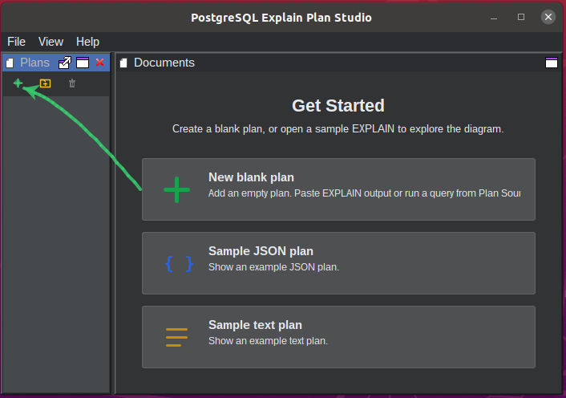
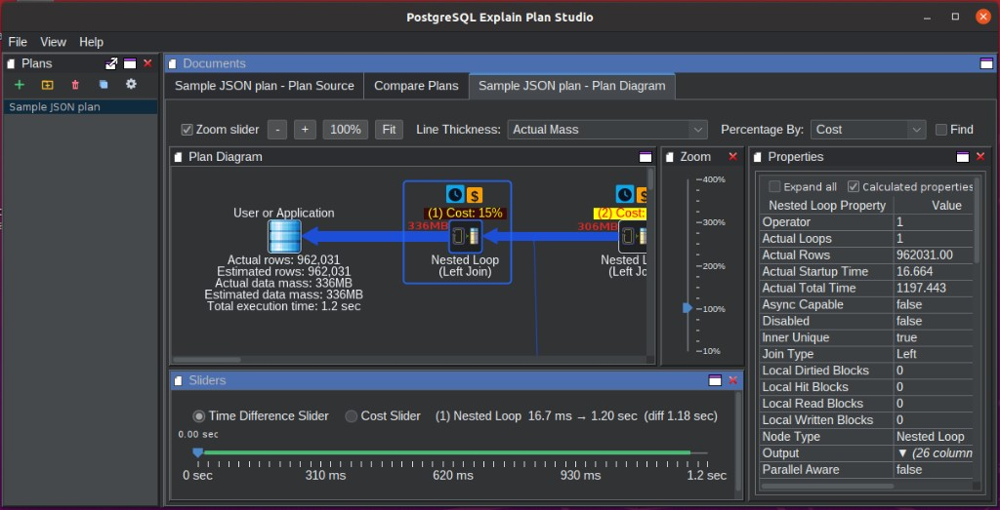

# Getting started

Open PEPS and create your first plan diagram from a sample or a blank document.

## Steps

1. Launch **PostgreSQL Explain Plan Studio**.
2. If no plans are open yet, the **Get Started** view offers:
   - **New blank plan** -- empty Plan Source for paste or connection.
   - **Sample JSON plan** -- loads a built-in JSON `EXPLAIN` sample and shows the diagram.
   - **Sample text plan** -- loads a built-in text `EXPLAIN` sample and shows the diagram.
3. Or use **Add Plan** in the Plans toolbar to create a document and click the **Plan Source** tab.

**Screenshot:** Get Started landing with the three actions

**Screenshot:** First Plan Diagram with Sample JSON

## Next

- [Managing plans](02-managing-plans.md)
- [Loading plans](03-loading-plans.md)
