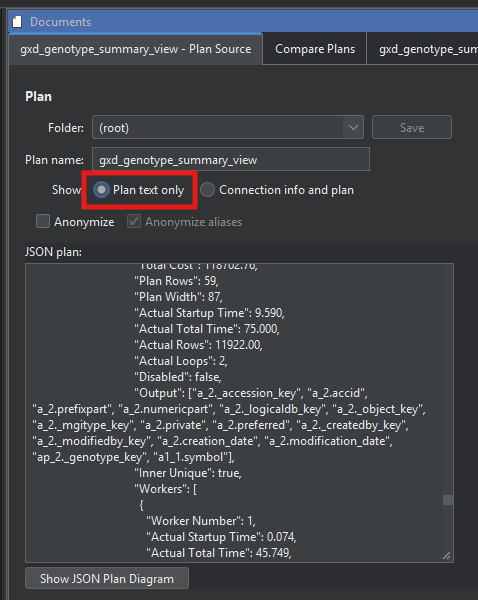
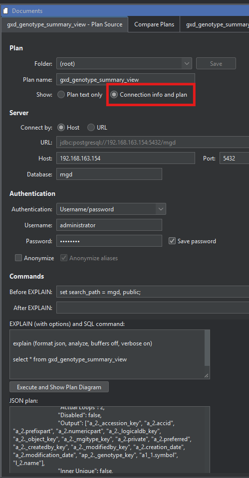

# Loading plans

Fill **Plan Source** by pasting an `EXPLAIN` result, or by running `EXPLAIN` against a database.

## Plan text only

1. Open a plan and select the **Plan Source** tab.
2. Choose **Plan text only**.
3. Paste JSON or text `EXPLAIN` output into the editor (format is detected automatically).
4. Optionally set a **Folder** and save.
5. Click **Show Plan Diagram** (button label may vary with format).

This mode hides the server, authentication, and SQL command fields. Use it when you only work with a JSON or text plan, or when you want to keep connection details out of view during a presentation.

**Screenshot:** Plan text only with pasted JSON

## Connection info and plan

1. Choose **Connection info and plan**.
2. Enter host (or URL), port, database, and authentication (username/password or trust).
3. Optionally **Save password**.
4. Adjust **Before / After EXPLAIN** and the SQL (default is JSON `EXPLAIN`).
5. Click **Execute and Show Plan Diagram**.

Switch back to **Plan text only** at any time to hide the connection and SQL fields.

**Screenshot:** Connection info form

## Next

- [Reading the diagram](04-reading-the-diagram.md)
