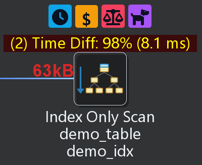

# Search and warnings

Find operators on the diagram and tune when warning chips appear.

## Find on the diagram

1. Press **Ctrl+F** (Windows/Linux) or **Cmd+F** (macOS), or enable **Find**.
2. Optionally filter by warning kinds: **Time**, **Cost**, **Rows**, **Filter**, **Heap**.
3. Use **Next** / **Previous** (or **Enter** / **F3**) to step through matches.
4. **Esc** closes the find bar.

**Screenshot:** Find bar with filters

<!-- Drop file at docs/user/images/ss-find-bar.png -->

## Warning indicators

Indicators appear north of some operators. Hover over an indicator to see its value.

<!--
  Avoid a side-by-side table here: Markdown preview / GitHub CSS often force
  vertical-align on cells (and strip style/valign), which parks the icon+label
  at the bottom of tall Meaning rows. Stacked entries keep icon, name, and
  text top-aligned without fighting that.
-->

<strong>Actual vs Estimate ratio</strong> 
Operators where estimated and actual values differ by orders of magnitude.

<strong>Cost %</strong> 
The operators with the highest individual cost. Usually only the top two are marked; more appear only when their percentages are equal.

<strong>Filter removes rows</strong> 
Operators that discard a significant amount of data before emitting the rest.

<strong>Heap fetch</strong> 
Index-only scans that still had to visit the table heap for a high share of rows, which usually means the visibility map is out of date. Consider running VACUUM on that table.

<strong>Opr time %</strong> 
The operators that took the longest. Usually only the top two are marked; more appear only when their percentages are equal.

Example of where warning indicators will appear.

## Warning thresholds

In application **Settings**, adjust thresholds that drive chips and Find filters, including:

- Minimum actual rows / mass
- Actual vs estimated factor
- Filter %
- Heap fetch %

**Screenshot:** Warning threshold Settings

<!-- Drop file at docs/user/images/ss-warning-settings.png -->

## Next

- [Metrics and compare](06-metrics-and-compare.md)
