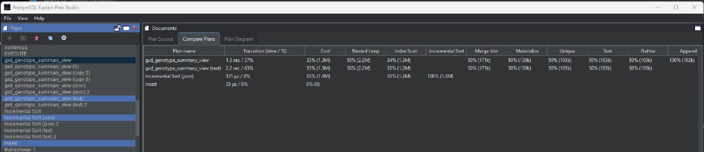

# Metrics and compare

Control how edge thickness and percentages reflect cost or time, and compare several plans side by side.

## Line thickness and Percentage By

On the diagram toolbar / **Sliders** dock:

- **Line thickness** — actual or estimated mass/rows, or actual-vs-estimated ratios.
- **Percentage By** — cost, operator time, or time difference (options depend on plan data).
- Sliders emphasize hotspots (for example time difference vs cost).

**Screenshot:** Sliders and Percentage By

<!-- Drop file at docs/user/images/ss-metrics-sliders.png -->

## Compare Plans

1. Multi-select plans in the Plans tree, or use the context menu **Compare Plans**.
2. Open the **Compare Plans** tab for a table of plan-level and operator-type metrics.

**Screenshot:** Compare Plans table

<!-- Drop file at docs/user/images/ss-compare-plans.png -->

## Next

- [Anonymize and translate](07-anonymize-and-translate.md)
