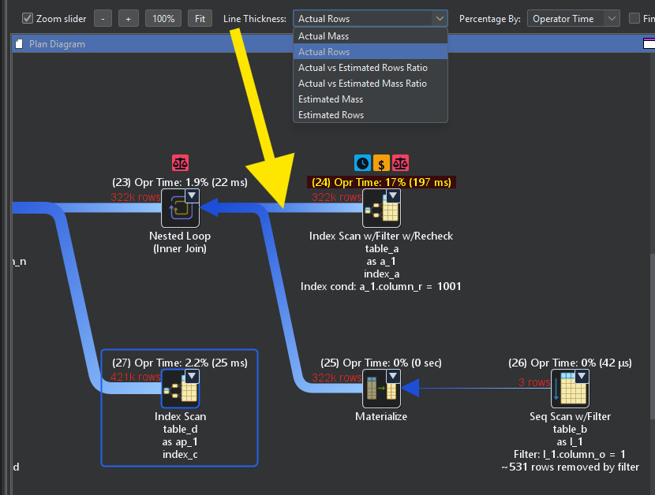

# Metrics and compare

Control how edge thickness and percentages reflect cost or time, and compare several plans side by side.

## Line thickness and Percentage By

On the diagram toolbar / **Sliders** dock:

- **Line Thickness** — chooses the value shown west of each operator and scales each arrow's thickness by it. Options are actual or estimated mass/rows, or actual-vs-estimated ratios.
  - **Mass** is the amount of data an operation moves (kB, MB, GB, and so on).
  - The **Actual vs Estimated** ratio options are different: a thin line means actual and estimated are close or equal; a thick line means they differ by orders of magnitude. A thick line often points to a table worth tuning, for example with VACUUM / ANALYZE settings.
- **Percentage By** — chooses the value shown north of each operator: cost, operator time, or time difference (options depend on plan data). The highest value is red on yellow and the second highest is yellow on dark red, so hotspots stand out.
- Sliders emphasize hotspots (for example time difference vs cost).

**Screenshot:** Sliders and Percentage By

<!-- Drop file at docs/user/images/ss-metrics-sliders.png -->

## Compare Plans

1. Multi-select plans in the Plans tree, or use the context menu **Compare Plans**.
2. Open the **Compare Plans** tab for a table of plan-level and operator-type metrics.

**Screenshot:** Compare Plans table

<!-- Drop file at docs/user/images/ss-compare-plans.png -->

## Next

- [Anonymize and translate](07-anonymize-and-translate.md)
