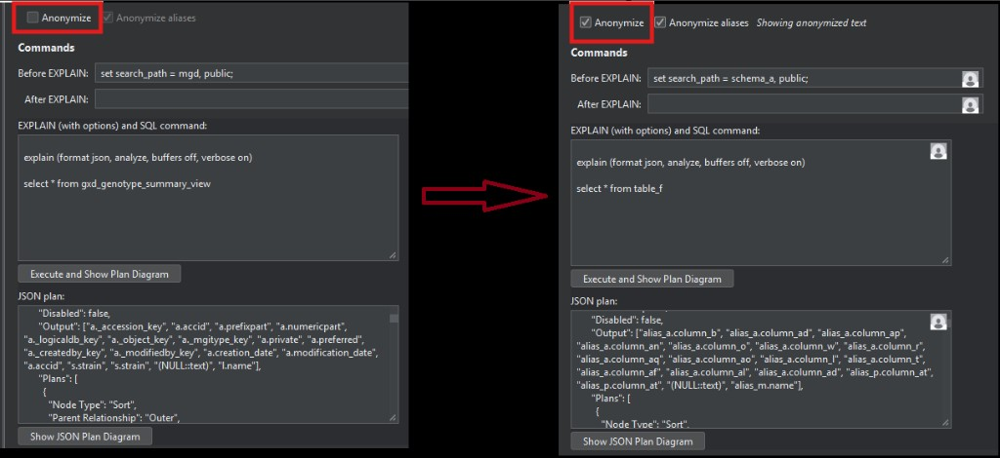
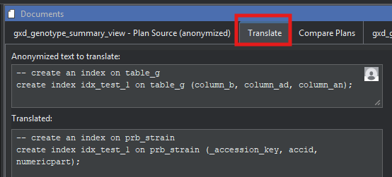

# Anonymize and translate

Share plans without exposing real table or column names, then map anonymized SQL back to originals.

## Anonymize

1. Open a plan that has source text or a diagram.
2. Use **Anonymize** (optionally **Anonymize aliases**).
3. Confirm badges / “Showing anonymized text” so you know the anonymized view is active.

**Screenshot:** Anonymize controls and badge

<!-- Drop file at docs/user/images/ss-anonymize.png -->

## Translate

1. Open the **Translate** tab.
2. Paste anonymized SQL (or related text).
3. Use the live mapping back to original identifiers as needed.

**Screenshot:** Translate tab

<!-- Drop file at docs/user/images/ss-translate.png -->

## Next

- [Customize the UI](08-customize-ui.md)
