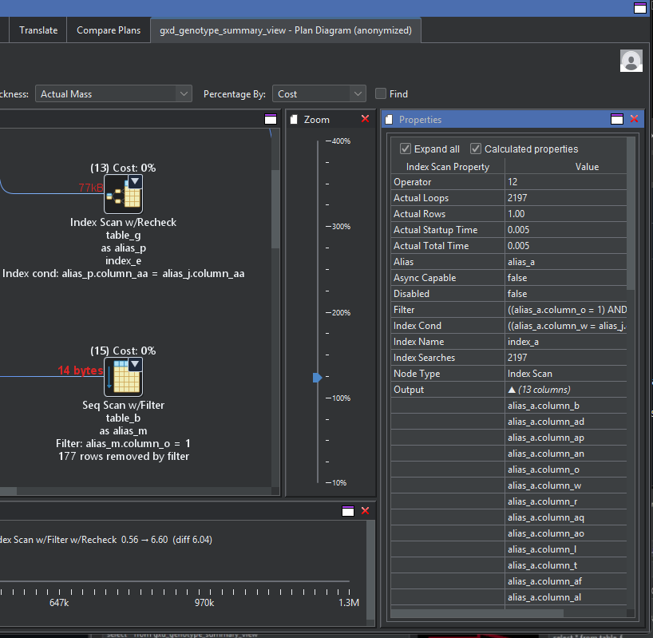

# Anonymize and translate

Share plans without exposing real table or column names, then map anonymized SQL back to originals.

## Anonymize

**Anonymize** masks schemas, tables, columns, indexes, other database objects, and strings so you can share your SQL and plan outside your organization. Mass, row counts, timings, and costs are kept.

1. Open a plan that has source text or a diagram.
2. Use **Anonymize** (optionally **Anonymize aliases**).
3. Confirm badges / “Showing anonymized text” so you know the anonymized view is active.

While Anonymize is on:

- The original SQL is kept in the database.
- The SQL, the JSON/text plan, and the plan diagram are anonymized.
- The SQL and plan text fields are read-only, so you can safely copy all or part of them (and the diagram) to others for analysis.

**Anonymize aliases** controls whether aliases for tables, views, columns, subqueries, and so on are masked too. Leave it off when aliases are not sensitive and keeping them will help the other person analyze the plan.

**Screenshot:** Anonymize off vs on

**Screenshot:** Plan Diagram with Anonymize on

## Translate

When the other party sends back their analysis, translate it to your real names:

1. Open the **Translate** tab.
2. Paste the analysis (anonymized SQL or related text) into the **Anonymized text** field at the top.
3. Read the translated result in the field below; the live mapping back to original identifiers saves you from translating by hand.

**Screenshot:** Translate tab

